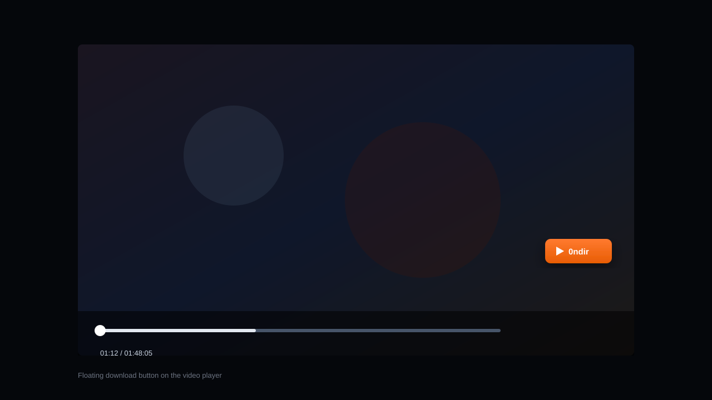
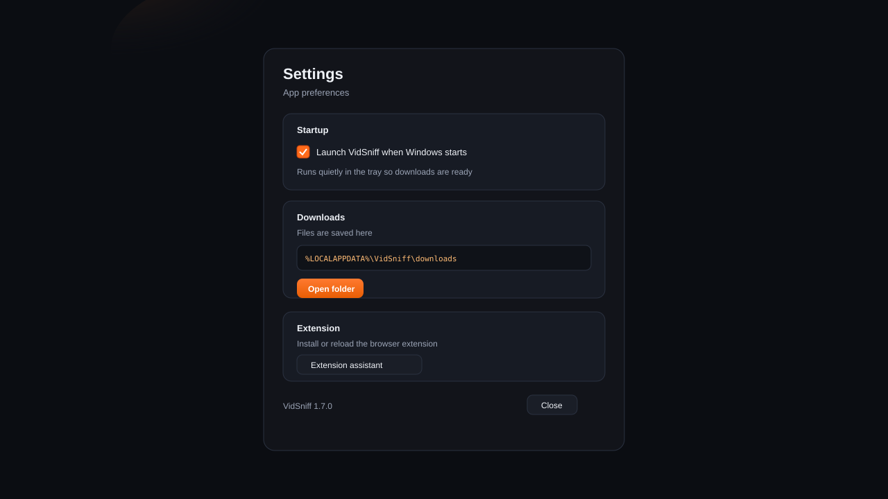

# VidSniff

**EN** · Browser video sniffer + local MP4 downloader. Tray app + extension. Captures HLS streams and saves them as MP4.

**TR** · Tarayıcıdan video yakalayan, yerel olarak MP4 indiren araç. Tepsi uygulaması + eklenti. HLS akışlarını MP4 olarak kaydeder.




---

## Features / Özellikler

| EN | TR |
| --- | --- |
| Floating **Download** button on video players | Video üzerinde yüzen **İndir** butonu |
| Tray download panel with progress | Tepsi indirme paneli + ilerleme |
| HLS → MP4 (with audio when available) | HLS → MP4 (mümkünse sesli) |
| Extension install assistant | Eklenti kurulum asistanı |
| Settings: start with Windows | Ayarlar: Windows ile başlat |
| Chrome / Edge / Brave (+ Firefox temporary) | Chrome / Edge / Brave (+ Firefox geçici) |




---

## Install (users) / Kurulum (kullanıcı)

### 1. App / Uygulama

Download the latest **Setup** from [Releases](../../releases):

- `VidSniff-Setup-x.y.z.exe`

Run the installer → Start Menu / Desktop shortcut → VidSniff stays in the system tray.

Windows ile her açılışta çalışsın istersen: **Ayarlar → Windows açılınca VidSniff’i başlat**.

### 2. Browser extension / Tarayıcı eklentisi (once)

1. Open VidSniff → **Eklenti kur** / tray → **Eklenti kurulum asistanı**
2. Click **Chrome için kur** or **Edge için kur**
3. Enable **Developer mode** → **Load unpacked**
4. Select: `%LOCALAPPDATA%\VidSniff\extension-chrome`

**Firefox / Zen:** unsigned extensions are temporary — `about:debugging` → Load Temporary Add-on →  
`%LOCALAPPDATA%\VidSniff\extension-firefox\manifest.json`

### 3. Use / Kullanım

1. Play a video in the browser  
2. Click the floating **İndir** button (or extension popup → **MP4 İndir**)  
3. Files: `%LOCALAPPDATA%\VidSniff\downloads`

---

## Project layout / Proje yapısı

```
desktop/       Electron tray app (panel, setup, settings)
downloader/    Local HTTP download service (HLS → MP4)
extension/     Browser extension (Chrome + Firefox manifests)
docs/          Screenshots & docs assets
scripts/       Build helpers (icons, pack extension)
```

Open and readable — no hidden packaging magic beyond Electron Builder.

---

## Develop / Geliştirme

```bash
npm install
npm run app          # tray app + downloader
npm start            # downloader only (no UI)
npm run pack:ext     # copy extension to LocalAppData + zip
npm run dist         # Windows Setup installer (NSIS)
npm run dist:portable # optional portable exe
```

Requirements: Node.js 18+, Windows. Optional: `ffmpeg` on PATH for best HLS remux.

---

## GitHub repo blurb / Kısa açıklama

**EN:** IDM-like video sniffer for the browser — tray app + extension that catches streams and saves MP4.

**TR:** Tarayıcı için IDM tarzı video yakalayıcı — tepsi uygulaması + eklenti ile akışı yakalayıp MP4 kaydeder.

Suggested topics: `video-downloader`, `hls`, `electron`, `browser-extension`, `mp4`, `chrome-extension`

---

## License

MIT — see [LICENSE](LICENSE).

Use only for content you have the right to download.
)
